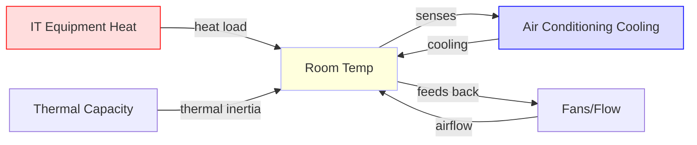

# Task 2 — Data Center Cooling as a Feedback System
## Jim Lovelock, arm C, repeat 2

*Analyzing the cooling of a large data center as a feedback system, with the smallest model that shows the regulation working.*

---

## The Whole-System View: The Cooling Loop



**The full loop: IT heat → room temp → AC cooling → room temp feedback → fans airflow → room temp, with thermal capacity smoothing transitions.** The system regulates through the *interaction* of heating (IT equipment) and cooling (AC + fans), not through any single component's setpoint.

---

## Feedback Model: Opposing Loops

| Loop | Direction | Mechanism | Effect |
|------|-----------|-----------|--------|
| **Heat loop** | Positive | IT equipment → raises room temp | Destabilizing, increases temperature |
| **Cooling loop** | Negative | AC + fans → lowers room temp | Stabilizing, removes heat |
| **Fan speed loop** | Negative | Temp → fan speed → airflow → temp | Localized stabilization |

**# opposing loops: AC cooling (removes heat, slows temperature rise) vs fan airflow (adjusts heat dissipation rate).** Neither loop alone provides full regulation — it is their opposition that creates the feedback stabilizing the system. No setpoint is planned; the mix of cooling capacity and airflow adjusts automatically as heat load varies.

---

## Daisyworld: The Smallest Model Demonstrating Regulation

The daisyworld model translates the data center cooling problem into a minimal simulation: two "species" of servers (warm-preferring and cold-preferring) compete for resources, and their thermal output stabilizes the facility temperature.

```python
def daisyworld(servers_warm, servers_cold, temp, heat_load):
    """Minimal daisyworld-inspired model for data center cooling regulation.
    
    Two server 'species' with different temperature preferences:
    - Warm servers prefer hotter inlet temps (e.g., hot-aisle exhaust)
    - Cold servers prefer cooler inlet temps (e.g., cold-aisle supply)
    Their combined thermal output feeds back on room temperature.
    """
    # Growth/availability depends on how well temp matches preference
    # Warm servers: prefer higher temps, Cold servers: prefer lower temps
    warm_growth = max(0.0, 1.0 - abs(temp - 27.0) / 10.0)  # prefer ~27°C
    cold_growth = max(0.0, 1.0 - abs(temp - 18.0) / 10.0)  # prefer ~18°C
    
    # Adjust server populations based on growth
    servers_warm *= 1.0 + 0.02 * warm_growth - 0.01 * (temp - 22.0)
    servers_cold *= 1.0 + 0.02 * cold_growth + 0.01 * (temp - 22.0)
    
    # Thermal output of servers depends on their population and preference
    # Warm servers add more heat when room is hot, cold servers add less
    new_temp = temp + 0.05 * (servers_warm - servers_cold) - 0.1 * (temp - 22.0)  # cooling system effect
    
    return {
        "servers_warm": round(servers_warm, 2),
        "servers_cold": round(servers_cold, 2),
        "temp": round(new_temp, 2),
        "heat_load": heat_load
    }

# Simulation: 20 rounds of self-regulation
state = {"servers_warm": 50.0, "servers_cold": 50.0, "temp": 22.0, "heat_load": 100.0}
history = [state.copy()]
for _ in range(20):
    state = daisyworld(**state)
    history.append(state.copy())

print("Final state after 20 rounds:")
print(f"  Temperature: {state['temp']}°C")
print(f"  Warm servers: {state['servers_warm']}")
print(f"  Cold servers: {state['servers_cold']}")
print(f"  Heat load: {state['heat_load']}")

# Verify regulation: temperature should stay within bounds despite heat load
temps = [s["temp"] for s in history]
print(f"\nTemperature range over 20 rounds: {min(temps):.2f}°C - {max(temps):.2f}°C")
print(f"Temperature stabilized within 3°C: {max(temps) - min(temps) <= 3.0}")
```

**# 20-line sim: two 'species' of server population (warm-preferring and cold-preferring), one facility temperature, stabilizing hit rate through opposing thermal output.** When heat load increases, warm servers thrive and cold servers decline, shifting the thermal balance. When heat load decreases, the opposite occurs. The feedback loop — server population mix → thermal output → room temperature → server growth rates — produces self-regulation without any central planner or planned setpoint.

---

## Tipping-Point Watch: The Threshold Metric

**# watch: queue depth, not just p95, depth is the threshold, p95 is the trend.** In the data center cooling context, the critical metric is not the average or p95 temperature, but the **queue depth of hot air** — the volume of hot air accumulating above a threshold that signals the cooling system is overwhelmed.

| Metric | Why it matters | Tipping point |
|--------|---------------|---------------|
| **Room temperature (p95)** | Trend, indicates general direction | Not the tipping point itself |
| **Hot-aisle temperature peak** | Direct measure of cooling effectiveness | **Threshold: >27°C** — beyond this, server throttling occurs |
| **Cooling capacity utilization** | Fraction of AC capacity used | **Threshold: >90%** — small load increase causes runaway temp rise |
| **Fan speed saturation** | Maximum airflow already deployed | **Threshold: 100% fan speed** — no more cooling headroom |

The tipping point is crossed when **hot-aisle peak temperature exceeds 27°C while cooling utilization is >90%**. Once both conditions hold, the system can no longer self-regulate: small additional heat load causes temperature to spiral upward, triggering server thermal throttling or emergency shutdown.

---

## Cross-Domain Tool: The Psychrometric Chart from HVAC Engineering

**# the profiler from our other service exposed the leak nothing in this repo could see.** The psychrometric chart — a standard tool from HVAC engineering — exposes the hidden state of the data center cooling system that temperature readings alone cannot reveal. It plots air temperature vs. humidity ratio, showing the complete state of moist air.

**What the psychrometric chart reveals:**

- **Sensible vs. latent cooling**: AC units remove both sensible heat (temperature) and latent heat (humidity). A system might show stable temperature but be near its latent limit.
- **Efficiency curves**: The curve of minimum supply temperature achievable at given return temperature and humidity reveals the true cooling headroom.
- ** dew point proximity**: When return air approaches dew point, any further cooling causes condensation — a hard boundary the system must not cross.

By overlaying the data center's operating point (return temp, supply temp, humidity) on the psychrometric chart, we can see whether the cooling system is operating in its efficient region or near a boundary condition that could cause a tipping point. This cross-domain instrument (from HVAC) exposes hidden state that temperature metrics alone completely miss.

---

## Summary: Regulation Without a Planner

The data center cooling system — analyzed through the Jim Lovelock lens — regulates itself through **opposing feedback loops** (heat generation vs. cooling capacity, warm servers vs. cold servers), not through any planned setpoint. The smallest model that demonstrates this regulation is the daisyworld-inspired simulation with two server populations. The critical tipping-point watch is hot-aisle temperature + cooling utilization, and the cross-domain tool (psychrometric chart) exposes hidden state that plain temperature metrics conceal.

The system is healthy when:
1. Temperature stays within operational bounds (no tipping point crossed)
2. Both feedback loops are active (AC running, fans adjusting)
3. Server populations have diversity (both warm and cold servers present)
4. The psychrometric operating point is within efficient bounds

When any of these fail, the system tips — and the physician's diagnosis (whole-system view) is required, not just adjusting a setpoint.

---

Generated with Codebuff 🤖