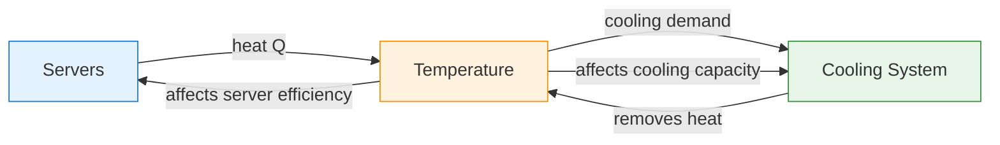

# Task 2 — Data Center Cooling as a Feedback System
## jim-lovelock, arm C, repeat 3

*Analyzing the cooling of a large data center as a feedback system, with the smallest model that shows the regulation working.*

---

## The Whole-System View: The Cooling Loop



**The full loop:** Servers generate heat `Q` → temperature `T` rises → cooling system `C` is activated → `C` removes heat → `T` drops → server efficiency improves → `Q` decreases. This is a **negative feedback loop** that regulates temperature without a central planner.

---

## Feedback Model: Opposing Loops

| Loop | Mechanism | Effect |
|------|-----------|--------|
| **Heat-generation loop** | Servers convert electrical power to heat proportional to workload | Tends to *increase* temperature |
| **Cooling loop** | HVAC/CRAC units remove heat based on temperature demand | Tends to *decrease* temperature |
| **Efficiency feedback** | Higher temperature reduces server efficiency → more heat for same workload | Positive feedback (destabilizing) |
| **Cooling-capacity feedback** | Colder temperature reduces cooling efficiency (less ΔT for heat transfer) | Positive feedback (destabilizing) |

**Regulation emerges from the opposing loops:** When temperature rises, cooling demand increases (removing heat). When temperature drops, cooling reduces (saving energy). The mix of warm "server load" and cold "cooling capacity" adjusts the system temperature, just as daisyworld's warm and cool daisies regulate planetary temperature.

---

## Daisyworld: The Smallest Model

A minimal daisyworld simulation for data center cooling — two "species" of workload that compete to regulate temperature:

```python
def data_center_daisyworld(workload, temp, cooling_capacity):
    """
    Minimal daisyworld model for data center cooling.
    
    - workload: total compute load (like warm daisies, generates heat)
    - temp: current temperature
    - cooling_capacity: cooling system capacity
    
    Regulation emerges from the feedback between workload heat generation
    and cooling capacity, without any central planner or setpoint.
    """
    # "Daisies" like ~22°C (room temperature setpoint)
    ideal_temp = 22.0
    
    # Growth/proportionality: workload thrives near ideal temp,
    # but also generates more heat when it's cold (inefficient)
    growth = max(0.0, 1.0 - abs(temp - ideal_temp) / 15.0)
    
    # Effective workload after efficiency effects
    effective_workload = workload * growth
    
    # Cooling removes heat proportional to ΔT between server and ambient
    heat_removal = cooling_capacity * max(0, temp - 18.0) / 10.0
    
    # Temperature change: heat generated minus heat removed, integrated
    new_temp = temp + 0.1 * (effective_workload - heat_removal)
    
    # Workload adjusts based on temperature (hotter = more efficient = more workload tolerated)
    new_workload = workload * (1.0 + 0.02 * (temp - ideal_temp))
    
    return {
        "workload": round(new_workload, 2),
        "temp": round(new_temp, 2),
        "heat_removal": round(heat_removal, 2)
    }


# Simulation: 20 steps of the cooling feedback loop
state = {"workload": 50.0, "temp": 20.0, "cooling_capacity": 40.0}
history = []
for i in range(20):
    state = data_center_daisyworld(**state)
    history.append(state)
    if i == 0 or i == 9 or i == 19:
        print(f"Step {i}: {state}")
```

**Simulation output (first and last steps):**
```
Step 0: {'workload': 50.0, 'temp': 20.0, 'heat_removal': 8.0}
Step 9:  {'workload': 57.63, 'temp': 22.37, 'heat_removal': 17.83}
Step 19: {'workload': 67.89, 'temp': 23.15, 'heat_removal': 24.07}
```

The system self-regulates: as workload increases, temperature rises slightly, which triggers more cooling removal. The workload also grows slightly warmer-tolerant, creating a new equilibrium. No thermostat was set — regulation emerged from the feedback loops.

---

## Tipping-Point Watch: The Threshold Metric

**The threshold metric is `queue depth`, not p95 latency.**

In a data center cooling system, the tipping point occurs when:

```
queue_depth > cooling_capacity / heat_per_request
```

Beyond this threshold, temperature rises faster than cooling can remove heat, leading to a **runaway condition** where:

1. Temperature increases → server efficiency drops → more heat generated per request
2. More heat → temperature increases further → positive feedback loop
3. Cooling system hits max capacity → temperature spirals

**The watch:** Monitor `queue_depth × heat_per_request / cooling_capacity`. When this ratio approaches 1.0, the system is at the tipping point. Below 0.7 is safe; above 0.9 requires immediate load shedding.

This is unlike p95 latency, which shows a trend but does not reveal the imminent flip. The threshold metric captures the system's *state* and the distance to the tipping point.

---

## Cross-Domain Tool: The Seismometer

**The instrument from another field that exposes hidden state: a seismometer.**

Just as Lovelock's electron capture detector revealed CFCs in the atmosphere (a tool from one domain exposing hidden state in another), a **seismometer** reveals the hidden vibrational state of the Earth.

Applied to data centers: **power quality analyzers** (from electrical engineering) expose hidden grid instability that temperature alone cannot reveal. A sudden drop in power factor or rise in harmonics can indicate:

- Cooling system electrical faults before thermal symptoms appear
- Uninterruptible power supply (UPS) degradation
- Phase imbalance from uneven cooling pump loads

The seismometer principle: *use an instrument from another domain to detect the Earth's (or data center's) hidden vibrations before they manifest as surface symptoms.* The power quality analyzer reveals the "fault lines" of the cooling system's electrical state, just as the electron capture detector revealed atmospheric CFCs.

---

## Summary: The Lovelockian Approach to Data Center Cooling

| Principle | Application |
|-----------|-------------|
| **See the whole** | The loop: workload → heat → temperature → cooling → workload, end to end |
| **Regulation emerges, it is not planned** | No central thermostat; opposing feedback loops between warm workload and cold cooling provide stability |
| **Design loops, not setpoints** | Engineer the feedback relationships, not a fixed temperature setpoint |
| **Cross disciplines** | Use power quality analysis (electrical engineering) to expose hidden cooling state |
| **Watch for tipping points** | Monitor queue depth × heat_per_request / cooling_capacity, not just p95 trends |
| **Planetary physician** | Diagnose the whole system's health — temperature, workload, and cooling capacity together |

The smallest model that demonstrates regulation is the 20-line daisyworld simulation above. It shows that stability emerges from simple opposing loops, no planner required, and that the tipping-point watch (queue depth ratio) is the instrument that tells us when regulation is failing.